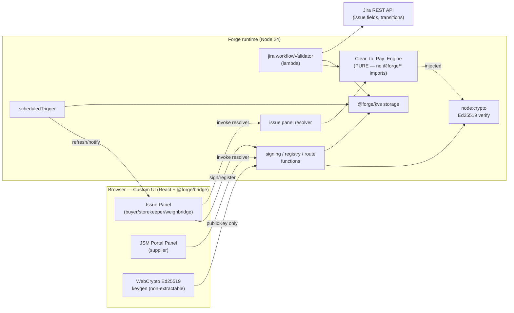
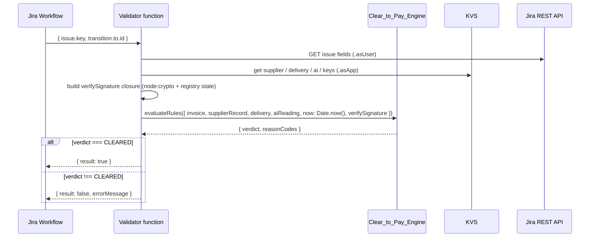

# Design Document — Clear to Pay Rules Engine

## Overview

This design covers the first working slice of **Clear to Pay for Jira**, a Forge app that stops a supplier invoice (a Jira issue) from reaching the **Paid** status until every payment-control rule passes.

The slice delivers:

- A **pure rules engine** (`src/rules/`) that takes an Invoice, Supplier_Record, Delivery, AI_Reading, and the current server time and returns a Verdict (`CLEARED`, `HELD`, `REFUSED`, `SEIZED`) plus every fired Reason_Code. The engine performs no side effects and makes no Jira calls, so it is fully unit-testable in isolation.
- **Six rules**, each exercising a different Forge feature: `SEIZED_PAYEE_NOT_REGISTERED`, `HELD_PAYOUT_COOL_OFF`, `HELD_ONE_SIGNATURE`, `HELD_COUNT_MISMATCH`, `HELD_AI_READING_ONLY`, and `REFUSED_BYPASS`.
- A **`jira:workflowValidator`** lambda that recomputes the verdict at transition time from current data and blocks any move to **Paid** unless the verdict is `CLEARED`. The validator runs for every transition initiator (UI, REST API, automation, bulk edit) because it is part of the Jira workflow definition.
- An **issue panel** (`jira:issuePanel`, Custom UI / React) that shows the six-rule checklist and every fired Reason_Code. The panel only displays; it never enforces.
- A **JSM portal request-detail panel** (`jiraServiceManagement:portalRequestDetailPanel`, Custom UI) where the supplier registers an ed25519 key and signs payout-route changes.
- **Real ed25519** signing and verification: signers create non-extractable WebCrypto keys in the browser; Forge verifies every signature with `node:crypto`. Private keys never leave the browser.
- A **public-key registry** in Forge Key-Value Storage, keyed by `accountId` + `role`, enforcing that one account never holds both delivery roles, with retroactive revocation.
- A **supplier payout-route registry** (one registered route per supplier) with a computed **72-hour cool-off** (`payableFrom = Date.now() + 72h`) on an approved change.
- A **`scheduledTrigger`** that, on cool-off expiry, only refreshes the issue panel and notifies users. It never grants payment; the engine computes cool-off independently of the trigger.
- A **test strategy**: six vitest attack tests (named for the attack each rule stops), a fast-check property proving no input lets an AI reading alone clear a payment, and an ed25519 round-trip property.

**Core security model (from `security.md`):** rules are enforced in Forge (workflow validator + Forge functions); the UI only shows results; signatures are real ed25519 verified server-side; the AI reads but never pays; a new or changed bank account waits 72 hours; a delivery needs two distinct signing roles; no data leaves Atlassian.

## Architecture

### Module fit

The app is structured as concentric layers around a pure core:

- **Pure core — `Clear_to_Pay_Engine`** (`src/rules/`). Plain JavaScript, no `import` of `@forge/api`, `@forge/kvs`, `@forge/resolver`, or `node:crypto`. It receives all data and a `verifySignature` callback as parameters, so it has zero Forge/Jira/SDK dependencies and runs under plain Node in vitest with no Atlassian platform present.
- **Forge function layer** (`src/functions/`). Loads data (Jira issue fields via the REST API; Supplier_Record, Key_Registry, Delivery, AI_Reading via KVS), builds a `verifySignature` closure backed by `node:crypto` and the current Key_Registry state, calls the engine, and acts on the result (block/permit a transition, render a panel, record a route change, register/revoke a key).
- **Forge modules** declared in `manifest.yml`:
  - `jira:workflowValidator` — lambda function; the only enforcement point for moving to **Paid**.
  - `jira:issuePanel` — Custom UI (React) for buyers, storekeepers, and weighbridge operators.
  - `jiraServiceManagement:portalRequestDetailPanel` — Custom UI for the supplier.
  - `scheduledTrigger` — cool-off expiry notification; never grants payment.
  - `function:` entries — resolvers/handlers for the above.
- **Storage layer** — Forge Key-Value Storage (`@forge/kvs`), accessed only via `.asApp()` from backend resolvers.

### Diagram — module topology



### Diagram — validator data flow



### Why the engine is testable in isolation

The engine module imports only the language standard library. Signature verification — the one thing that would otherwise force a Forge/`node:crypto` dependency — is **passed in** as the `verifySignature` parameter. In production the Forge function supplies a `node:crypto`-backed closure; in tests the same call site supplies a deterministic stub (stubs are confined to test files, per `security.md` rule 6). Because the engine never reaches outside itself, vitest can exercise every rule with no Jira, no KVS, and no Atlassian platform.

## Components and Interfaces

### 3.1 Clear_to_Pay_Engine (pure core)

**Location:** `src/rules/engine.js` (plus per-rule files in `src/rules/`).

**Signature:**

```javascript
/**
 * Evaluate all rules for one invoice.
 *
 * @param {object} input
 * @param {Invoice}        input.invoice        The invoice (Jira issue view).
 * @param {SupplierRecord} input.supplierRecord The supplier's record, or null if unknown.
 * @param {Delivery}       input.delivery       The delivery and its signatures.
 * @param {AIReading}      input.aiReading       The AI reading (advisory only).
 * @param {number}         input.now            Current server time (ms epoch). Never a client clock.
 * @param {(sig: Signature) => boolean} input.verifySignature
 *   Injected verifier. Returns true only for a signature whose public key is
 *   registered and active and whose value verifies against its payload under
 *   ed25519. The engine never imports node:crypto or @forge/kvs.
 * @returns {EngineResult} { verdict, reasonCodes }
 */
export function evaluateRules({ invoice, supplierRecord, delivery, aiReading, now, verifySignature }) { ... }
```

**Composition.** Each rule is a small pure function `ruleN(context) => ReasonCode | null`, where `context` bundles the inputs plus a memoized `verifySignature`. The engine:

1. Runs all six rule functions, collecting the non-null fired Reason_Codes in rule-table order.
2. Maps each fired code to its Verdict (`SEIZED_*` → `SEIZED`, `REFUSED_*` → `REFUSED`, `HELD_*` → `HELD`).
3. Picks the highest-precedence Verdict (`SEIZED` > `REFUSED` > `HELD` > `CLEARED`).
4. Returns `{ verdict, reasonCodes }` — the top Verdict and **all** fired codes (never only the top rule's code). If no rule fires, returns `{ verdict: 'CLEARED', reasonCodes: [] }`.

The engine is deterministic and referentially transparent: identical inputs produce identical output, and inputs are never mutated.

### 3.2 Rule functions (pure)

Each rule lives in its own file and returns a fired Reason_Code or `null`.

- **`rule1PayeeRegistered`** → `SEIZED_PAYEE_NOT_REGISTERED` or null. See §3.1 logic below.
- **`rule2PayoutCoolOff`** → `HELD_PAYOUT_COOL_OFF` or null.
- **`rule7OneSignature`** → `HELD_ONE_SIGNATURE` or null.
- **`rule8CountMismatch`** → `HELD_COUNT_MISMATCH` or null.
- **`rule17AiReadingOnly`** → `HELD_AI_READING_ONLY` or null.
- **`rule21Bypass`** is enforced by the **Workflow_Validator**, not the engine (see §3.3). It is listed among the six rules and rendered in the panel, but its firing is a property of the transition, not of the engine inputs.

#### Rule 1 — Payee Not Registered (`SEIZED_PAYEE_NOT_REGISTERED`)

- If `supplierRecord` is `null` (no record in KVS for the invoice's `supplierId`), fire `SEIZED_PAYEE_NOT_REGISTERED`.
- Else the registered payout account is `supplierRecord.payoutRoute.account`.
  - If the invoice names no bank account (`invoice.namedBankAccount == null`), the registered route is used → payee-matched, do **not** fire.
  - If `invoice.namedBankAccount === supplierRecord.payoutRoute.account`, payee-matched, do not fire.
  - If `invoice.namedBankAccount !== supplierRecord.payoutRoute.account` (names another account), fire.

The payout account is derived **only** from the Supplier_Record. Any account named in invoice text or in the AI_Reading is ignored for payout-account purposes (it is compared against the registered route for this rule only).

#### Rule 2 — Payout Cool-Off (`HELD_PAYOUT_COOL_OFF`)

- Requires a known `supplierRecord` with a `payoutRoute.payableFrom` (ms epoch).
- If `now < payableFrom`, fire `HELD_PAYOUT_COOL_OFF`.
- If `now >= payableFrom` (including `now === payableFrom` exactly), do not fire — the route is eligible.
- Edge case: `now === payableFrom` exactly is **eligible** (boundary is inclusive, so the cool-off does not fire at the instant it expires).

#### Rule 7 — Delivery One Signature (`HELD_ONE_SIGNATURE`)

- Count verified Signatures on the `delivery` whose `role` is `storekeeper` or `weighbridge`, where "verified" means `verifySignature(sig) === true` and the signer's key is currently registered and active.
- Distinct **roles** are required, not merely two signatures: collect the set of distinct roles among verified delivery signatures. If that set has fewer than two members (i.e., not both `storekeeper` and `weighbridge`), fire `HELD_ONE_SIGNATURE`.
- A Signature whose `verifySignature(sig) === false` does not count (tampered payload, tampered value, mismatched/revoked/missing key).
- A Signature with `role === 'supplier'` never counts as a `storekeeper` or `weighbridge` signature, even if it verifies.
- Two signatures from the same role (or same accountId) do not satisfy "two distinct roles."

#### Rule 8 — Count Mismatch (`HELD_COUNT_MISMATCH`)

- Requires **both** a `storekeeperCount` and a `weighbridgeCount` on the delivery.
- If both are present and `storekeeperCount !== weighbridgeCount` (any nonzero difference), fire `HELD_COUNT_MISMATCH`.
- If both are present and equal, do not fire.
- If either count is missing, do **not** fire this rule (a missing count is not a mismatch). Other rules may still fire.

#### Rule 17 — AI Reading Only (`HELD_AI_READING_ONLY`)

- "Clearance signals" are: a verified human `Signature` on the delivery, or a human approval recorded for the invoice. The AI_Reading is advisory only and is never a clearance signal.
- If `aiReading.present === true` **and** there is no human clearance signal, fire `HELD_AI_READING_ONLY`.
- If a human Signature verifies or a human approval is present, do **not** fire, regardless of whether an AI_Reading is also present.
- The AI_Reading has no payee field and cannot authorize payment. The payout account comes solely from the Supplier_Record (Rule 1).

### 3.3 Workflow Validator (`jira:workflowValidator`)

**Manifest wiring (preview module, lambda form):**

```yaml
modules:
  jira:workflowValidator:
    - key: ctp-paid-validator
      name: Clear to Pay — Paid transition guard
      description: Blocks any move to "Paid" unless the Clear to Pay verdict is CLEARED.
      function: ctp-validator
      projectTypes: ['company-managed', 'team-managed']
  function:
    - key: ctp-validator
      handler: validator.run
```

**Handler** (`src/functions/validator.js`):

```javascript
/**
 * Forge workflow validator. Invoked on every transition that has this
 * validator attached. Runs for all initiators (UI, REST, automation, bulk)
 * because Jira evaluates validators server-side as part of the workflow.
 *
 * @returns {{ result: boolean, errorMessage?: string }}
 */
export const run = async (args) => { ... };
```

Flow:

1. Read `args.issue.key`. Load the Invoice from Jira issue fields (`.asUser()`) and the Supplier_Record, Delivery, AI_Reading, and Key_Registry entries from KVS (`.asApp()`). The transition's destination status is available in `args.transition.to`; the guard only acts when the destination is **Paid** (the validator is attached to that transition, so being invoked implies a Paid-bound transition; the handler still confirms the destination as defense in depth).
2. Build `verifySignature` as a closure over the loaded Key_Registry: for a given `Signature`, look up the key by `accountId`+`role` (and `keyId`), reject if the key is missing or `status === 'revoked'`, otherwise run `node:crypto` Ed25519 verify (see §3.9). This closure reflects **current** registry state, so a key revoked after a signature was made causes that signature to fail verification now — retroactive revocation.
3. Call `evaluateRules({ invoice, supplierRecord, delivery, aiReading, now: Date.now(), verifySignature })`.
4. If `verdict === 'CLEARED'`, return `{ result: true }`. Otherwise return `{ result: false, errorMessage: 'Clear to Pay ' + verdict + ' — ' + reasonCodes.join(', ') }`. The issue stays in its pre-transition status; post-functions do not run.

**Coverage of all initiation channels (Req 8.3, 9.3).** Workflow validators are evaluated by Jira as part of the transition pipeline, independent of how the transition is started. A move made through the Jira UI, the REST API, an automation rule, or a bulk edit all run the same workflow, so the same validator fires for each. This is a Jira platform guarantee, not app code; it is verified by integration tests (1–2 examples per channel) rather than a property test.

**No cached verdict (Req 9.1, 9.5).** The validator never reads a previously stored verdict. It always recomputes from data current at the moment of the transition, with `now = Date.now()` read server-side at that moment.

**Unprotected-transition warning (Req 9.4).** The issue panel resolver performs a **best-effort** check: it queries the issue's available transitions (`GET /rest/api/3/issue/{key}/transitions`), and for any transition whose destination is **Paid**, attempts to confirm our `ctp-paid-validator` is attached. Positive confirmation of validator attachment is not reliably exposed by the Jira public REST API, so the resolver uses a conservative fallback: if a Paid transition is reachable and attachment cannot be positively confirmed, the panel displays a warning. This is defense-in-depth only; the enforcement guarantee rests on the validator itself, which blocks whenever it is attached. This mechanism is the most uncertain part of the design and is flagged as a known limitation (see §9 Out of Scope and §10 Assumptions).

### 3.4 Issue Panel (`jira:issuePanel`, Custom UI)

**Manifest wiring:**

```yaml
modules:
  jira:issuePanel:
    - key: ctp-issue-panel
      resource: ctp-panel
      resolver:
        function: ctp-panel-resolver
      viewportSize: medium
      title: Clear to Pay
  function:
    - key: ctp-panel-resolver
      handler: panel.handler
resources:
  - key: ctp-panel
    path: static/ctp-panel/build
```

The panel is a Custom UI React app (the existing `static/hello-world` is repurposed and renamed to `static/ctp-panel`). It uses `@forge/bridge` `invoke` to call Forge resolvers and renders with standard React (see §3.9 / §10 for why Custom UI, not UI Kit, is required here).

**Responsibilities:**

- Display the six-rule checklist: for each of the six Reason_Codes, show **pass** when the code is absent from the fired list, **hold** when present with the `HELD_` prefix, and **fail** when present with the `SEIZED_` or `REFUSED_` prefix.
- Display exactly the Reason_Codes returned by the engine — adding none and omitting none. When no rule fires, no Reason_Code entries are shown.
- Provide a **signing surface** (role-gated) for storekeepers, weighbridge operators, and buyers to register ed25519 keys and sign deliveries/approvals via the Custom UI (see §3.9).
- Optionally display the unprotected-transition warning (§3.3).

**The panel never enforces.** It does not compute a Verdict, fire a Reason_Code, or block a transition. It only renders results computed by the Forge function, which calls the engine. The panel delegates to the resolver; the resolver calls the engine; the panel shows the engine's output.

### 3.5 JSM Portal Supplier Signing Panel (`jiraServiceManagement:portalRequestDetailPanel`)

A minimal Custom UI panel shown on a service management request so the **supplier** can:

- Register an ed25519 public key under role `supplier` (the private key never leaves the browser; only the public key is sent to the Forge function).
- Sign a payout-route change payload (the new bank account) so the Forge function can record the change with buyer approval.

This is deliberately minimal: the supplier's key registration and route-change signing, nothing more. Portal theming (navy/gold vs kiroween) is out of scope for this slice (§9).

### 3.6 Key Registry Service

**Forge functions** (`src/functions/keyRegistry.js`) over KVS:

- `registerKey({ accountId, role, publicKeySpkiB64 })` — store a key under `key:{accountId}:{role}`. Refuses if:
  - `role` is `storekeeper` or `weighbridge` and the account already holds the **other** delivery role (one account never holds both).
  - The account already holds the same role without first revoking the existing key.
  - `role` is `supplier` — stored separately, never conflicts with delivery roles.
  - A private key is submitted (rejected without storing or using; Req 11.5).
- `revokeKey({ accountId, role })` — set `status = 'revoked'`, `revokedAt = Date.now()`. Retroactive: because verification re-checks `status` at verify time, every signature made with that key — including those made before revocation — fails verification from this point on.
- `rotateKey({ accountId, role, newPublicKeySpkiB64, approvedBy })` — implemented as `revoke` followed by `register` of the new key, gated on `approvedBy` being a Jira admin (Req 12.6, 12.8). Without admin approval, the new registration is refused and the existing key is left unchanged.

The engine never touches the Key_Registry directly; it only sees the registry through the injected `verifySignature` closure.

### 3.7 Payout Route Service + Cool-Off

**Forge function** `recordPayoutRouteChange({ supplierId, newAccount, supplierSignature, buyerApprovalAccountId })` (Req 13.4, 13.5, 14.1):

1. Verify the supplier signature with `node:crypto` against the supplier's registered public key in the Key_Registry (role `supplier`). If it fails or no supplier key is registered, refuse and leave the existing route unchanged.
2. Confirm `buyerApprovalAccountId` is present and is a buyer. If missing, refuse and leave the existing route unchanged.
3. Only when both succeed, set `Supplier_Record.payoutRoute = { account: newAccount, payableFrom: Date.now() + 72 * 60 * 60 * 1000 }` and store it under `supplier:{supplierId}`.

The engine later reads `payableFrom` and compares it to the injected `now` (Rule 2). The engine never sets `payableFrom`; only this Forge function does.

### 3.8 scheduledTrigger

**Manifest:**

```yaml
modules:
  scheduledTrigger:
    - key: ctp-cooloff-trigger
      function: ctp-trigger
      interval: hour
  function:
    - key: ctp-trigger
      handler: trigger.run
```

The handler scans KVS for suppliers whose `payableFrom` has just passed and, for each, **only** refreshes the issue panel state and notifies users (e.g., a Jira comment or panel refresh signal). It **never** alters a Verdict and never authorizes payment. The engine's cool-off evaluation is independent of whether the trigger has run: a trigger that is absent or late neither releases a route before `payableFrom` nor holds it after `payableFrom` has passed (Req 14.4, 14.5). Notification that writes a Jira comment would require `write:jira-work`; to keep scopes minimal, this slice prefers panel-only notification and treats a comment as optional (§5).

### 3.9 Custom UI (browser) — ed25519 signing and verification

**Browser side** (`static/ctp-panel/src/crypto.js`):

- **Key generation:** `crypto.subtle.generateKey('Ed25519', false /* non-extractable */, ['sign', 'verify'])`. `extractable: false` means the private `CryptoKey` can never be exported or read out. The `CryptoKey` is persisted in **IndexedDB** so it survives reloads without ever leaving the browser (it is a non-extractable key handle, not raw key material).
- **Public key transport:** export the public key with `crypto.subtle.exportKey('spki', publicKey)` → 44-byte SPKI DER → base64. Only `{ publicKeySpkiB64 }` is sent to the Forge function. The private key is never stored, logged, or transmitted (Req 11.2, 11.4).
- **Signing:** `crypto.subtle.sign('Ed25519', privateKey, payloadBytes)` → 64-byte signature → base64. The submitted object is `{ payload, signatureB64, signerAccountId, role, keyId }`. The private key never appears in any submitted or stored object.

**Server side** (`src/functions/signature.js`):

```javascript
import crypto from 'node:crypto';

/**
 * Verify one ed25519 signature server-side.
 * @param {Signature} sig   has signatureB64, payload, signerAccountId, role, keyId
 * @param {KeyEntry}  key   the registered public key (status active) for that signer+role
 * @returns {boolean}
 */
export function verifyEd25519(sig, key) {
  if (!key || key.status === 'revoked') return false;
  const pubKey = crypto.createPublicKey({
    key: Buffer.from(key.publicKeySpkiB64, 'base64'),
    format: 'der',
    type: 'spki',
  });
  return crypto.verify(
    null,                                  // Ed25519 takes no separate digest
    Buffer.from(sig.payload, 'utf8'),      // the exact bytes that were signed
    pubKey,
    Buffer.from(sig.signatureB64, 'base64'),
  );
}
```

The Forge function layer wraps this in the `verifySignature(sig) => boolean` closure that the engine receives: it looks up the key in the current Key_Registry by `accountId`+`role` (and `keyId`), then calls `verifyEd25519`. This is the exact verification contract the engine relies on.

**Runtime assumption.** `node:crypto` supports Ed25519 (`crypto.verify` with an Ed25519 `KeyObject`) on Node 12+; the Forge runtime declared in `manifest.yml` is `nodejs24.x`, which supports it. (`tech.md` mentions Node 22 for the local nvm dev environment; both Node 22 and 24 support Ed25519. See §10.)

**Private-key rejection (Req 11.5).** If a Forge function ever receives a private key (e.g., a `privateKey` field), it rejects the request without storing or using it. Private keys live only in the browser as non-extractable `CryptoKey` handles.

## Data Models

Vanilla JavaScript with JSDoc `@typedef` (the project uses no TypeScript). Field names below are the design decision the requirements left open.

```javascript
/** @typedef {'CLEARED'|'HELD'|'REFUSED'|'SEIZED'} Verdict */
/** @typedef {'SEIZED_PAYEE_NOT_REGISTERED'|'HELD_PAYOUT_COOL_OFF'|'HELD_ONE_SIGNATURE'|'HELD_COUNT_MISMATCH'|'HELD_AI_READING_ONLY'|'REFUSED_BYPASS'} ReasonCode */

/**
 * @typedef {object} Invoice  — a supplier invoice as a Jira issue view.
 * @property {string} issueKey           Jira issue key, e.g. "PROJ-123".
 * @property {string} supplierId         The supplier identity (custom field), e.g. "SUP-0042".
 * @property {(string|null)} namedBankAccount
 *   A bank account named in invoice text, or null if the invoice names none.
 *   Compared against the registered Payout_Route for Rule 1.
 */

/**
 * @typedef {object} PayoutRoute
 * @property {string} account      The registered bank account identifier.
 * @property {number} payableFrom  ms epoch; the route may be paid when now >= payableFrom.
 */

/**
 * @typedef {object} SupplierRecord
 * @property {string} supplierId
 * @property {PayoutRoute} payoutRoute  Exactly one registered payout route.
 */

/**
 * @typedef {object} Signature
 * @property {string} payload          The exact string that was signed (UTF-8 bytes).
 * @property {string} signatureB64    base64 of the 64-byte ed25519 signature.
 * @property {string} signerAccountId Atlassian accountId of the signer.
 * @property {('storekeeper'|'weighbridge'|'supplier')} role
 * @property {string} keyId           Identifier of the registered key used.
 */

/**
 * @typedef {object} Delivery
 * @property {string} deliveryId
 * @property {string} issueKey         The invoice this delivery fulfils.
 * @property {(number|null)} storekeeperCount   Blind count from the storekeeper, or null.
 * @property {(number|null)} weighbridgeCount   Blind count from the weighbridge operator, or null.
 * @property {Signature[]} signatures  Delivery signatures (storekeeper/weighbridge/supplier).
 */

/**
 * @typedef {object} AIReading  — advisory only; has NO payee field.
 * @property {boolean} present  True when an AI reading exists for this invoice.
 * @property {string} [summary] Optional human-readable summary. Never a clearance signal.
 * NOTE: deliberately no payee/account field; the AI cannot name a payout account.
 */

/**
 * @typedef {object} EngineResult
 * @property {Verdict} verdict
 * @property {ReasonCode[]} reasonCodes  Every fired Reason_Code, in rule-table order.
 */

/**
 * @typedef {object} KeyEntry  — one row in the Key_Registry (KVS).
 * @property {string} accountId
 * @property {('storekeeper'|'weighbridge'|'supplier')} role
 * @property {string} keyId
 * @property {string} publicKeySpkiB64   base64 SPKI DER of the ed25519 public key.
 * @property {'active'|'revoked'} status
 * @property {number} registeredAt      ms epoch.
 * @property {(number|null)} revokedAt  ms epoch when revoked, else null.
 */

/**
 * @typedef {object} HumanApproval — a human (buyer) approval recorded for an invoice.
 * @property {string} issueKey
 * @property {string} approverAccountId  The buyer who approved.
 * @property {number} approvedAt         ms epoch.
 */
```

Precedence helper:

```javascript
const VERDICT_RANK = { SEIZED: 3, REFUSED: 2, HELD: 1, CLEARED: 0 };
/** Highest-precedence verdict among fired codes; CLEARED when none fire. */
function topVerdict(firedCodes) { ... }
```

## Storage Layout

All app data lives in **Forge Key-Value Storage** (`@forge/kvs`), accessed only via `.asApp()` from backend resolvers (per `AGENTS.md`: storage APIs have no client-side API and must use `.asApp()`). No data leaves Atlassian (Runs-on-Atlassian eligibility, `security.md` rule 7).

| KVS key                          | Value                  | Purpose                                                |
|----------------------------------|------------------------|--------------------------------------------------------|
| `supplier:{supplierId}`         | `SupplierRecord`       | One registered payout route per supplier (Rule 1, 2).  |
| `key:{accountId}:{role}`         | `KeyEntry`             | Public-key registry; role ∈ storekeeper/weighbridge/supplier. |
| `delivery:{issueKey}`            | `Delivery`             | Blind counts + delivery signatures (Rules 7, 8).      |
| `ai:{issueKey}`                  | `AIReading`            | The AI reading input (Rule 17).                        |
| `approval:{issueKey}`            | `HumanApproval`        | A recorded buyer approval (clearance signal for Rule 17). |

Jira issue fields (the Invoice) are read from Jira via the REST API using `.asUser()`, not stored in KVS. `supplierId` and `namedBankAccount` are read from custom fields on the issue (the specific custom-field IDs are a build-time configuration decision).

**REST vs storage split (per `AGENTS.md`):**

- Use `.asUser()` for product REST calls (reading Jira issue fields, transitions). `.asUser()` carries its own authorization check.
- Use `.asApp()` only for KVS (storage has no client-side API and requires `.asApp()`).

**Manifest scopes (kept minimal):**

- `read:jira-work` — read issue fields; also required so the workflow validator receives `modifiedFields`.
- `storage:app` — required by `@forge/kvs`.
- `write:jira-work` — **only if** the scheduledTrigger posts a Jira comment for notification. To stay minimal, this slice prefers panel-only notification and treats the comment as optional; the scope is added only if that feature is built.
- `manage:jira-configuration` — only if expression-based validator configuration pages are used; the lambda validator needs none, so this scope is **not** added.

The JSM portal module may require an additional service-management scope; it will be added only if the resolver cannot operate on the request context with the scopes above, keeping the set minimal.


## Correctness Properties

*A property is a characteristic or behavior that should hold true across all valid executions of a system — essentially, a formal statement about what the system should do. Properties serve as the bridge between human-readable specifications and machine-verifiable correctness guarantees.*

The rules engine is a pure function with a large input space, so property-based testing applies directly. Properties 1–8 and 10 target the pure engine (and the panel renderer, which is also pure). Properties 9, 11–17 target the Forge function layer (validator, signature verification, key registry, payout route, scheduledTrigger); these are exercised with `node:crypto` and in-memory KVS fakes in tests, never against live Atlassian services. Channels-coverage (Req 8.3, 9.3), the unprotected-transition warning (Req 9.4), and scheduledTrigger notification (Req 14.3) are integration/smoke concerns and are covered in the Testing Strategy, not as PBT properties.

### Property 1: Engine purity and determinism

*For any* inputs to the `Clear_to_Pay_Engine`, two calls with identical inputs (including the injected `verifySignature`) return the same `{ verdict, reasonCodes }` in the same order, the engine imports no `@forge/*` or `node:crypto` module, and the supplied `Invoice`, `SupplierRecord`, `Delivery`, and `AIReading` are not mutated. The result always has a `verdict` (one of the four) and a `reasonCodes` array.

**Validates: Requirements 1.1, 1.2, 1.3, 1.4, 1.5, 1.6**

### Property 2: Verdict precedence returns all fired reason codes

*For any* inputs where one or more rules fire, the returned `verdict` equals the highest-precedence fired rule (`SEIZED` above `REFUSED` above `HELD` above `CLEARED`) and the returned `reasonCodes` list contains exactly every fired Reason_Code, in rule-table order. *For any* inputs where no rule fires, the verdict is `CLEARED` with an empty `reasonCodes` list.

**Validates: Requirements 2.1, 2.2, 2.3, 2.4**

### Property 3: Payee mismatch seizes

*For any* invoice and supplier, when the invoice names a bank account that differs from the Supplier_Record's registered Payout_Route, or when no Supplier_Record exists for the invoice's `supplierId`, the verdict is `SEIZED` and `SEIZED_PAYEE_NOT_REGISTERED` fires. *For any* invoice that names no account (using the registered route) or names an account equal to the registered route, the rule does not fire.

**Validates: Requirements 3.1, 3.2, 3.3, 3.4**

### Property 4: Cool-off boundary is inclusive

*For any* `now` and `payableFrom`, when `now < payableFrom` the verdict is `HELD` and `HELD_PAYOUT_COOL_OFF` fires; when `now >= payableFrom` — including the exact case `now === payableFrom` — the rule does not fire. The engine evaluates the cool-off solely from the injected `now` (server time) compared to `payableFrom`, independently of whether any scheduledTrigger has run.

**Validates: Requirements 4.1, 4.2, 4.3, 14.2, 14.5**

### Property 5: One signature requires two distinct verified roles

*For any* delivery, when the set of roles among its **verified** signatures does not include both `storekeeper` and `weighbridge`, the verdict is `HELD` and `HELD_ONE_SIGNATURE` fires. A signature that fails verification, or whose key is missing or revoked, does not count; a `supplier` signature never counts as a storekeeper or weighbridge signature. *For any* delivery carrying verified signatures from both a storekeeper and a weighbridge (distinct accountIds), the rule does not fire.

**Validates: Requirements 5.1, 5.2, 5.3, 5.4**

### Property 6: Count mismatch fires only when both counts differ

*For any* delivery carrying both a storekeeper count and a weighbridge count, when the two differ by any nonzero amount the verdict is `HELD` and `HELD_COUNT_MISMATCH` fires; when they are equal the rule does not fire. *For any* delivery missing either count, `HELD_COUNT_MISMATCH` does not fire.

**Validates: Requirements 6.1, 6.2, 6.3**

### Property 7: No AI reading alone clears a payment

*For any* inputs where an AI_Reading is present and no verified human Signature and no human approval clears the invoice, the verdict is not `CLEARED` and `HELD_AI_READING_ONLY` fires. *For any* inputs where a verified human Signature or a human approval is present, `HELD_AI_READING_ONLY` does not fire regardless of an AI_Reading's presence. The AI_Reading never carries a payee/account field and is never a clearance signal.

**Validates: Requirements 7.1, 7.2, 7.3, 7.5, 15.2**

### Property 8: The payout account always comes from the supplier record

*For any* inputs, the payout account used by the engine equals the Supplier_Record's registered Payout_Route and never equals an account named in invoice text or in the AI_Reading. Each Supplier_Record holds exactly one registered Payout_Route.

**Validates: Requirements 7.4, 13.1, 13.2, 13.3**

### Property 9: The validator recomputes and blocks non-CLEARED Paid transitions

*For any* transition into "Paid", the Workflow_Validator's decision depends solely on data current at the moment of transition (with `now = Date.now()` read server-side) and never on a previously stored or cached verdict. *For any* such transition whose recomputed verdict is not `CLEARED`, the validator blocks the transition (the issue remains in its pre-transition status) and the outcome is `REFUSED` with `REFUSED_BYPASS`. *For any* such transition whose recomputed verdict is `CLEARED`, the validator permits the transition.

**Validates: Requirements 8.1, 8.2, 9.1, 9.2, 9.5**

### Property 10: The issue panel is a pure renderer

*For any* engine result, the issue panel renders exactly the `reasonCodes` the engine returned — adding none and omitting none — mapping each of the six rules to pass (code absent), hold (code present with `HELD_` prefix), or fail (code present with `SEIZED_`/`REFUSED_` prefix), and never computes a verdict, fires a reason code, or blocks a transition.

**Validates: Requirements 10.1, 10.2, 10.3**

### Property 11: Signature verification is a round trip

*For any* ed25519 key pair, a signature produced in the browser verifies in the Forge function with `node:crypto`; a signature over a tampered payload fails verification; a tampered signature value fails verification; and a signature whose signer's key is not present in the Key_Registry (or is revoked) is rejected as invalid.

**Validates: Requirements 11.3, 11.6, 11.7, 15.3**

### Property 12: The private key never leaves the browser

*For any* signing or registration operation performed by the Custom UI, the data transmitted to and stored by the Forge function contains only the public key, the payload, and the signature — never the private key. If a private key is submitted to a Forge function, it is rejected without being stored or used.

**Validates: Requirements 11.2, 11.4, 11.5**

### Property 13: One account never holds both delivery roles

*For any* accountId, registration of a second delivery role is refused when a first delivery role is already held, and re-registration of a delivery role the account already holds is refused unless the existing key for that role is first revoked. Supplier keys are stored separately and never conflict with delivery-role keys.

**Validates: Requirements 12.2, 12.3, 12.4, 12.7**

### Property 14: Revocation is retroactive

*For any* revoked key, signatures made with that key — including signatures made before the revocation — fail verification after revocation, because verification re-checks the key's status against the current Key_Registry at evaluation time.

**Validates: Requirement 12.5**

### Property 15: Key rotation requires admin approval

*For any* key rotation attempted without approval by a Jira admin, the new registration is refused and the existing key is left unchanged. *For any* rotation with admin approval, the rotation is performed as a revocation of the old key followed by registration of the new key.

**Validates: Requirements 12.6, 12.8**

### Property 16: A payout-route change requires supplier signature and buyer approval

*For any* payout-route change submitted with both a verified supplier Signature and a buyer approval, the Supplier_Record is updated to hold the new Payout_Route as its sole registered route with `payableFrom = now + 72h`. *For any* change submitted without a supplier Signature or without buyer approval, the existing registered Payout_Route is left unchanged.

**Validates: Requirements 13.4, 13.5, 14.1**

### Property 17: The scheduledTrigger never grants payment

*For any* state, the scheduledTrigger's effect is limited to refreshing the issue panel and notifying users; it never alters a verdict, records a payout route, or authorizes payment. The engine's cool-off outcome is unchanged by whether the trigger has run (see Property 4).

**Validates: Requirements 14.4, 14.5**

## Error Handling

The system fails closed: an error or missing datum never silently lets money move.

- **Workflow validator.** If any required input fails to load (Jira API error, KVS miss for the supplier, malformed data), the validator returns `{ result: false, errorMessage }` so the transition is blocked. A loaded but incomplete record is handled by the rules themselves (see below). The validator never returns `{ result: true }` on an exception.
- **Unknown supplier (Req 3.2).** A missing Supplier_Record is not an error to swallow; it is a rule input that fires `SEIZED_PAYEE_NOT_REGISTERED`. The engine receives `supplierRecord = null`.
- **Missing delivery counts (Req 6.3).** Missing counts do not fire `HELD_COUNT_MISMATCH`; they simply do not satisfy that rule. Other rules may still fire.
- **Unverified / missing / revoked signatures (Req 5.3, 11.6, 11.7, 12.5).** A signature that fails `verifySignature` is not counted and is not an engine error. A missing key in the registry is treated as a failed verification. A revoked key fails verification at evaluation time.
- **Signature verification exceptions.** `node:crypto` errors (bad SPKI, bad base64) are caught by the `verifySignature` closure and mapped to `false` (signature does not count); they never throw into the engine.
- **Private-key submission (Req 11.5).** If a Forge function receives any field resembling a private key, the request is rejected without storing or using it.
- **Invalid payout-route change (Req 13.5).** A change without a supplier signature or buyer approval is refused and the existing route is left unchanged; no partial update is written.
- **Issue panel.** If the resolver fails to compute a verdict, the panel shows an error state rather than fabricating a `CLEARED` result; it never enforces.
- **Tampered / replayed signatures.** Beyond ed25519 verification, the signed payload is a canonical, role-scoped string (see §Testing Strategy) so a signature made for one purpose cannot be replayed for another. Full replay protection (Rule 4, `REFUSED_REPLAY`) is out of scope for this slice (§9).

## Testing Strategy

**Dual approach.** Six vitest attack tests (unit, named for the attack each rule stops) plus fast-check property tests (universal) plus an ed25519 round-trip property. Unit tests catch concrete bugs; property tests verify general correctness across the input space.

**Property-based testing library:** `fast-check` (per `tech.md`). Each property test runs a minimum of 100 generated inputs. Each property test maps to exactly one design property above and is tagged with a comment:

```
// Feature: clear-to-pay-rules-engine, Property 7: No AI reading alone clears a payment
```

### File layout

```
src/
  rules/
    engine.js
    rule1.js ... rule17.js
    __tests__/
      engine.purity.property.test.js     // Property 1
      verdict.precedence.property.test.js // Property 2
      rule1.payee.attack.test.js          // attack test + Property 3
      rule2.cooloff.property.test.js      // Property 4 (+ attack test)
      rule7.onesignature.property.test.js// Property 5 (+ attack test)
      rule8.countmismatch.property.test.js// Property 6 (+ attack test)
      rule17.aionly.property.test.js      // Property 7 (headline) + attack test
      payout.source.property.test.js      // Property 8
      bypass.validator.property.test.js   // Property 9 (+ attack test for REFUSED_BYPASS)
      panel.render.property.test.js       // Property 10
  functions/
    signature.js
    keyRegistry.js
    payoutRoute.js
    validator.js
    trigger.js
    __tests__/
      signature.roundtrip.property.test.js// Property 11
      privacy.privatekey.property.test.js // Property 12
      keyRegistry.conflict.property.test.js// Property 13
      keyRegistry.revocation.property.test.js// Property 14
      keyRegistry.rotation.property.test.js // Property 15
      payoutRoute.change.property.test.js   // Property 16
      trigger.bounded.property.test.js       // Property 17
```

### The six attack tests (Req 15.1, 15.5)

Each is a vitest test named for the attack it stops (not the rule number), asserting the verdict and reason code:

1. **`diverts payment to an unregistered account`** → `SEIZED` + `SEIZED_PAYEE_NOT_REGISTERED`.
2. **`pays a freshly changed bank account before anyone notices`** → `HELD` + `HELD_PAYOUT_COOL_OFF` (`now < payableFrom`).
3. **`one person fabricates both sides of a delivery`** → `HELD` + `HELD_ONE_SIGNATURE`.
4. **`overstates delivered quantity`** → `HELD` + `HELD_COUNT_MISMATCH`.
5. **`an AI endorsement is treated as enough to pay`** → `HELD` + `HELD_AI_READING_ONLY`.
6. **`payment is pushed through by API or automation`** → `REFUSED` + `REFUSED_BYPASS` (exercises the Workflow_Validator function).

### The fast-check "no AI reading alone clears" property (Req 15.2)

`rule17.aionly.property.test.js` implements Property 7 over 100+ inputs. The generator produces arbitrary `{ invoice, supplierRecord, delivery, aiReading }` where the only clearance signal is an `AIReading` with `present: true` and **no** verified human signature and **no** human approval — including adversarial inputs (AI readings that look authoritative, multiple AI readings, AI readings alongside unverified/supplier signatures that must not count). The assertion: `verdict !== 'CLEARED'` and `reasonCodes` includes `HELD_AI_READING_ONLY`.

### The ed25519 round-trip property (Req 15.3)

`signature.roundtrip.property.test.js` implements Property 11 with **no mocks**: it uses `crypto.subtle` (WebCrypto, available in Node 18+ as `globalThis.crypto.subtle`) to generate an Ed25519 key, sign a payload, and then `node:crypto.verify` to verify — a genuine cross-API round trip mirroring browser→Forge. It asserts the signature verifies, that a tampered payload fails, and that a tampered signature value fails.

### How the pure engine is tested with no Jira

The engine module imports nothing from `@forge/*` or `node:crypto`, so engine tests run under plain Node in vitest with no Atlassian platform. The `verifySignature` dependency is injected: tests pass a deterministic stub that decides pass/fail from a flag on each `Signature` (e.g., `sig.verified`). Real `node:crypto`/`crypto.subtle` is used only in `signature.roundtrip.property.test.js`. **Mocks are confined to test files** (Req 15.4, `security.md` rule 6); production code uses real ed25519 implementations.

### Integration and smoke tests (not PBT)

- **Channel coverage (Req 8.3, 9.3).** 1–2 integration examples per channel (UI, REST API, automation, bulk edit) confirming the validator blocks a non-CLEARED transition. These verify the Jira platform guarantee that validators run for all initiators; they are not property tests because behavior does not vary with our code.
- **Unprotected-transition warning (Req 9.4).** An example test of the panel resolver's best-effort detection and its conservative fallback.
- **scheduledTrigger (Req 14.3).** A smoke test that the trigger refreshes the panel/notify path on cool-off expiry and never calls the engine.

Integration tests against `cleartopay.atlassian.net` wiring are noted as a later slice (§9); this slice's tests run against the pure engine and the Forge function layer with in-memory KVS fakes.

## Out of Scope / Limits

Each limit is a deliberate design choice for this slice, with the protection that still holds.

- **The other rules (3–6, 9–16, 18–20, 22).** This slice implements only rules 1, 2, 7, 8, 17, 21. *Protection:* the workflow validator (rule 21) blocks any non-`CLEARED` move to Paid, so an invoice that would fail a not-yet-built rule and happens to otherwise clear is only at risk if that rule's condition is not yet modeled — the bypass guard and the six implemented rules still raise the bar far above "trust the AI." Future rules plug into the same pure engine and precedence aggregator without touching the validator.
- **JSM portal theming beyond the minimal supplier signing panel.** *Protection:* themes change labels and colours only, never rules (`product.md`); the supplier signing surface is functional this slice, themed later.
- **Full Rovo agent AI-reading production.** This slice treats the AI_Reading as a stored input the engine consumes correctly (rule 17). *Protection:* rule 17 makes an AI reading alone never clear a payment regardless of how the reading was produced; the AI has no payee field and no approve action (`security.md` rule 1).
- **Theming (navy/gold vs kiroween).** *Protection:* labels and colours come from CSS variables and never alter rules (`product.md`); both themes render the same checklist from the same engine output.
- **End-to-end integration tests against `cleartopay.atlassian.net`.** *Protection:* the pure engine and Forge function layer are covered by unit + property tests with in-memory KVS fakes; integration wiring is a later, additive slice that does not change the engine.
- **Replay protection (rule 4 `REFUSED_REPLAY`).** *Protection:* signed payloads are canonical, role-scoped strings, so a signature cannot be reused across purposes within this slice; full replay tracking arrives with rule 4.
- **Detecting validator attachment for the unprotected-transition warning (Req 9.4).** The Jira public REST API does not reliably expose whether a transition carries our validator. *Protection:* the resolver uses a conservative fallback (warn when a Paid transition is reachable and attachment cannot be positively confirmed), and the actual enforcement guarantee rests on the validator itself, which blocks whenever attached.

## Assumptions and Open Items

Stated assumptions for choices the steering files leave silent (low-stakes structural choices), and the few open items to confirm during the build.

- **Runtime.** `manifest.yml` declares `nodejs24.x`; `tech.md` cites Node 22 for the local nvm dev environment. Ed25519 in `node:crypto` is supported on both. The Forge runtime is taken as `nodejs24.x`. Open item: confirm the runtime key (`nodejs24.x` vs `nodejs22.x`) in the manifest during the build; both support Ed25519.
- **Custom UI vs UI Kit.** The signing/keygen surfaces require real-browser WebCrypto (`crypto.subtle.generateKey('Ed25519', ...)`, non-extractable keys), which is unavailable in the UI Kit sandbox. `tech.md` specifies Custom UI for the issue panel and JSM portal, and the ed25519 requirement forces it; the issue panel is therefore Custom UI (the existing `static/hello-world` React app, repurposed as `static/ctp-panel`). This overrides the general UI-Kit-only preference in `AGENTS.md` for these surfaces specifically, because UI Kit cannot access browser WebCrypto.
- **Public-key transport format.** Browser exports the public key as SPKI DER (base64); Forge imports it with `crypto.createPublicKey({ format: 'der', type: 'spki' })` and verifies with `crypto.verify(null, payload, key, signature)`. Assumption: this is the cleanest Ed25519 interop between WebCrypto and `node:crypto`; confirmed supported on the target runtimes.
- **KVS key string formats.** `supplier:{supplierId}`, `key:{accountId}:{role}`, `delivery:{issueKey}`, `ai:{issueKey}`, `approval:{issueKey}`. Exact strings are a build-time decision; the `{role}` values are `storekeeper`, `weighbridge`, `supplier`.
- **Invoice fields.** `supplierId` and `namedBankAccount` are read from custom fields on the Jira issue; the specific custom-field IDs are a build-time configuration decision.
- **scheduledTrigger notification.** Panel-only notification is the default to keep scopes minimal; posting a Jira comment would add `write:jira-work` and is optional.
- **JSM portal scope.** The supplier portal panel may need an additional service-management scope; it will be added only if the resolver cannot operate on the request context with `read:jira-work` + `storage:app`.
- **Open item — the unprotected-transition warning (Req 9.4).** Best-effort detection with a conservative fallback is specified; the exact Jira REST query for confirming validator attachment is the riskiest part of this design and is to be validated early in the build. If no reliable signal exists, the conservative "warn unless positively confirmed" behavior stands, with the validator as the real enforcement.
